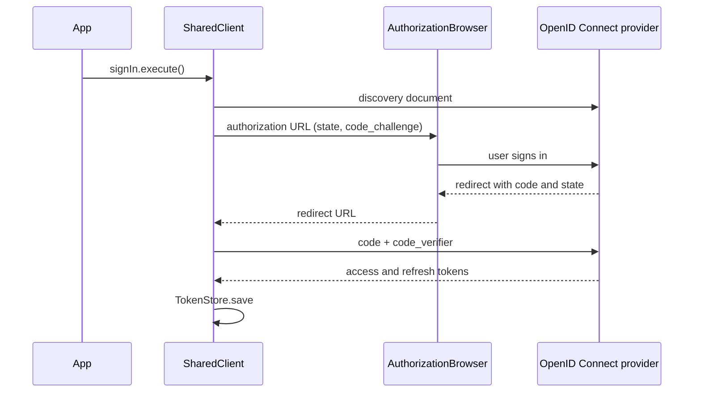
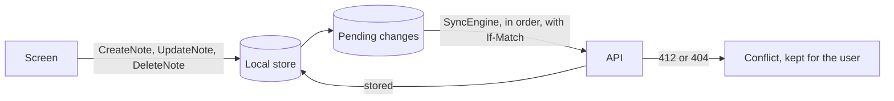

# Native clients

The native clients share one Kotlin Multiplatform library, `apps/clients/shared` (`:apps:clients:shared`). It holds everything that talks to the API: the client generated from the contract, the OpenID Connect sign-in, the use cases, and the local store that lets the apps work offline. The apps implement their UI and a few platform adapters, nothing else.

## A hexagon, like an API module

```text
apps/clients/shared/src/commonMain/kotlin/dev/ylp/client/
├── SharedClient.kt              composition root: builds everything, exposes the use cases
├── LocalStore.kt                the SQLite database; each platform opens it (openLocalStore)
├── PlatformAdapter.kt           base class of a port implemented in Swift
├── notes/
│   ├── domain/                  Note, SyncState, NoteConflict, NoteDraft (the contract's limits), results,
│   │                            ports: NoteGateway (the API), NoteStore (the device)
│   ├── application/             ListNotes, GetNote, CreateNote, UpdateNote, DeleteNote,
│   │                            GetConflict, ResolveConflict; LocalNotes, the notes' replayer and strategy
│   └── adapter/out/             http/HttpNoteGateway, over the generated client; local/SqlNoteStore
├── sync/
│   ├── domain/                  PendingChanges (port), ChangeOperation, ChangeReplayer, SyncResult
│   ├── application/             SyncEngine, SyncChanges, CountPendingChanges
│   └── adapter/out/local/       SqlPendingChanges, SqlDeviceData
└── auth/
    ├── domain/                  Tokens, AuthConfig, ports: TokenStore, AuthorizationBrowser, IdentityProvider, DeviceData
    ├── application/             SignIn, SignOut, CurrentSession
    └── adapter/out/             oidc/KtorIdentityProvider, memory/InMemoryTokenStore
```

The SQL schema lives in `src/commonMain/sqldelight`; SQLDelight generates its queries, made `internal` by the build like the API client.

- **The domain** holds the model and the ports. It knows neither Ktor nor the generated code.
- **A use case** is a class with one `execute` method. It checks its input against the contract's limits before any call, so a screen can show the problem without a round trip.
- **Adapters** are `internal`. A platform reaches the library through `SharedClient` and its use cases only.
- **The generated client** (`dev.ylp.client.generated`) is `internal` too, and only the HTTP adapter and the composition root use it.

`ArchitectureTest` (Konsist, in `jvmTest`) checks these rules, as `HexagonalArchitectureTest` does for the API.

## What a platform provides

| Port | Role |
| --- | --- |
| `AuthorizationBrowser` | Opens the provider's sign-in page and returns the redirect URL, or null when the user cancels |
| `LocalStore` | The database of notes and pending changes |
| `TokenStore` | Keeps the tokens between launches |

<!-- client:mobile:start -->
The Android app (`apps/clients/android`, see [Run the Android app](../contributor/how-to/run-the-android-app.md)):

- `CustomTabsBrowser`: a Custom Tab, the redirect back through `dev.ylp.notes://callback`;
- `openLocalStore(context)`: the app's databases folder;
- `KeystoreTokenStore`: AES-GCM with a key of the AndroidKeyStore, excluded from backups.

The iOS app (`apps/clients/ios`, see [Run the iOS app](../contributor/how-to/run-the-ios-app.md)):

- `WebAuthenticationBrowser`: `ASWebAuthenticationSession`, the same redirect;
- `openLocalStore(name:)`: Application Support;
- `KeychainTokenStore`: one Keychain item, this device only, available after the first unlock.
<!-- client:mobile:end -->

<!-- client:cli:start -->
The CLI (`apps/clients/cli`, see [Run the CLI](../contributor/how-to/run-the-cli.md)):

- `LoopbackBrowser`: the user's browser, the redirect back to a one-shot server on `127.0.0.1` (RFC 8252), used when the provider has no device flow;
- `openLocalStore(directory)`: `$XDG_DATA_HOME/notes`;
- `CommandTokenStore`: the Keychain through `security`, or libsecret through `secret-tool`, the secret on their standard input; `FileTokenStore`, mode `0600`, without a secret store.
<!-- client:cli:end -->

`InMemoryTokenStore` is the default: tokens live as long as the process. An app then builds the client once:

```kotlin
val client = SharedClient(
    apiBaseUrl = "https://example.org/api/v1",
    auth = AuthConfig(issuer = "https://idp.example.org", clientId = "mobile", redirectUri = "dev.ylp.notes://callback"),
    browser = platformBrowser,
    localStore = openLocalStore(context),
    tokenStore = platformTokenStore,
)
when (val result = client.listNotes.execute()) {
    is NotePageResult.Success -> show(result.page.notes)
    is NotePageResult.Failed -> show(result.failure)
}
```

## Sign-in

The library implements Authorization Code with PKCE (RFC 7636, `S256`) itself, rather than through a per-platform library such as AppAuth: the protocol is written and tested once, for every platform.



- A redirect whose `state` differs from the request's is refused: it does not answer this sign-in.
- Every API call carries the stored access token. On a 401 the library refreshes it once and retries; if the refresh fails, it clears the store and the call answers `SignedOut`.
- `Tokens`, `AuthorizationRequest` and `DeviceAuthorization` hide their secrets from `toString`, so a log never prints them.

### The device flow

A client without a browser of its own signs in with `SignInOnDevice` (RFC 8628): the provider gives a short code, the client shows it through its `DeviceCodeDisplay`, and the user types it on any device while the client polls the token endpoint at the interval the provider names, 5 seconds slower after each `slow_down`. A provider whose discovery document has no `device_authorization_endpoint`, such as the local mock-oauth2-server, answers `Unsupported`: the client then uses `SignIn` with a browser.
The CLI signs in this way, and falls back to a browser on the same computer ([ADR 0030](decisions/0030-native-cli-with-the-device-flow-and-the-system-secret-store.md)). <!-- client:cli -->

## Offline

Every write goes to the local store first, then to a queue of changes the API does not have yet; the queue replays at once when it can ([ADR 0029](decisions/0029-offline-native-clients-with-a-queue-and-a-conflict-strategy-per-entity.md)). The same code runs online and offline.



- **Reads**: `ListNotes` and `GetNote` read the API when it answers and keep what it returns; otherwise they read the device, and the page says `offline`. Notes the API does not have yet come first, notes deleted here are hidden, and synced notes the API no longer lists are forgotten.
- **Writes**: a note written offline gets a local `id`, and shows under the API's id once stored; on this device, both ids keep finding it, so a screen that held the local one still works. `Note.sync` says `SYNCED`, `PENDING` or `CONFLICTING`.
- **The queue**: one change per entity, merged with the next one (create then update is one create; create then delete is nothing); changes replay in the order of their first change, each based on the version the device last saw. The replay stops when the API cannot be reached or the session ends, and skips a conflict without holding the other notes back.
- **When it replays**: before a list, after each write or resolution, and when an app calls `SyncChanges`, such as when the system reports a network.
- **Signing out** wipes the store, changes not sent included: the apps ask first when `CountPendingChanges` is not 0. Signing in as another user (the ID token's `sub`) starts from an empty store; the same user keeps their pending changes.

### Conflicts: the notes strategy

A change the API refuses stays on the device, next to what the API holds, until the user resolves it with `ResolveConflict`. `GetConflict` returns both sides and the resolutions that apply:

| Conflict | Resolutions |
| --- | --- |
| `CHANGED_ELSEWHERE`, a change | `KEEP_MINE` (sent again on the latest version), `KEEP_THEIRS` (mine dropped), `KEEP_BOTH` (mine becomes a new note) |
| `CHANGED_ELSEWHERE`, a deletion | `KEEP_MINE` (deleted anyway), `KEEP_THEIRS` (the note comes back) |
| `DELETED_ELSEWHERE` | `KEEP_MINE` (written again as a new note), `KEEP_THEIRS` (mine dropped) |
| `REJECTED`: the API refuses the change itself | `KEEP_THEIRS` only |

A deletion of a note also deleted elsewhere is no conflict: both sides agree.

### Another entity

`dev.ylp.client.sync` knows no entity. An entity that works offline adds its tables in `src/commonMain/sqldelight`, a store port and adapter, and a `ChangeReplayer` registered in `SharedClient`: it sends one queued change, stores the answer, and turns a refusal into the entity's own conflict, resolved by its own use case. That strategy is a decision, stated in the replayer's KDoc like a use case's [conflict policy](overview.md#optimistic-concurrency).

<!-- client:cli:start -->
## The command line

`apps/clients/cli` is a Kotlin/Native binary, `notes`, for macOS and Linux: Clikt commands in `commonMain` over `SharedClient`, the platform adapters in `nativeMain`, `macosMain` and `linuxMain`. Its `jvm` target ships nowhere: it runs the commands' tests with Kover at 80%. The tests start a fake API and identity provider on a local Ktor server, and replace the secret tools with scripts. See [Run the CLI](../contributor/how-to/run-the-cli.md) and [Use the CLI](../product/use-the-cli.md).
<!-- client:cli:end -->

## Errors

| API answer | Result |
| --- | --- |
| 401 after a failed refresh, or no session | `NoteFailure.SignedOut` |
| 404 | `NoteFailure.NotFound`: missing, or someone else's |
| 412 | A conflict on the note, kept for the user (`SyncState.CONFLICTING`); the replay sees `NoteFailure.Changed` |
| 400, 413 | `NoteFailure.Invalid`, with the problem's `detail` |
| Anything else, or no network | `NoteFailure.Unavailable`; a list or a note already read comes from the device instead |

<!-- client:mobile:start -->
## Within Swift export's limits

The iOS app reaches the library through Kotlin's Swift export, still in Alpha. It supports `final` classes inheriting from `Any`, sealed classes (as Swift enums), `suspend` functions (as `async`) and `Flow` (as `AsyncSequence`), but not generic types or functions. Hence the public API:

- returns one sealed result type per operation (`NoteResult`, `NotePageResult`, `DeleteNoteResult`) rather than a generic `Result<T>`;
- exposes `data` classes and sealed hierarchies only;
- hands no list of enum constants to Swift, which crashes casting it to a Swift array: `NoteConflict.allows(resolution)` answers instead of a list of resolutions.

`ArchitectureTest` fails when a public class, interface or function declares a type parameter. Swift export also leaves out default arguments (Swift passes every parameter, `Int` as `Int32`), and flattens only the root package `dev.ylp.client`: the iOS app names the other types once, in `SharedNames.swift`. If Swift export blocks on a construct, the fallback is the Objective-C export with SKIE ([ADR 0027](decisions/0027-ios-app-swift-export-and-xcodegen.md)).

The module reaches Xcode through `embedSwiftExportForXcode`, which an Xcode build phase calls: Xcode builds the Kotlin code with the app, for the simulator or a device as it needs.

From Swift, a port is a protocol; its implementation inherits from `PlatformAdapter`, because Swift export lets a Swift class implement a Kotlin interface only through an exported Kotlin superclass:

```swift
final class KeychainTokenStore: PlatformAdapter, TokenStore {
    func load() async throws -> Tokens? { ... }
    func save(tokens: Tokens) async throws { ... }
    func clear() async throws { ... }
}

switch try await client.listNotes.execute(page: 0, size: 20).sealedType() {
case .success(let success): show(success.value.page.notes)
case .failed(let failed): show(failed.value.failure)
}
```
<!-- client:mobile:end -->

## The generated client

The `openapi-kotlin-client` convention generates Ktor calls and kotlinx.serialization models in `commonMain` on every build. Two quirks of the generator are handled:

- its multiplatform templates ignore `nonPublicApi` in a few files, so the build makes every generated top-level declaration `internal` afterwards;
- it renames a property called `size` to `propertySize`.

A contract change regenerates the client, and the HTTP adapter stops compiling where it no longer matches.

## Targets and tests

| Target | Used by | Tests |
| --- | --- | --- |
| `android` | the Android app | `commonTest` on the host JVM <!-- client:mobile --> |
| `iosArm64`, `iosSimulatorArm64` | the iOS app, through Swift export | `commonTest` on the simulator, macOS with Xcode only <!-- client:mobile --> |
| `macosArm64`, `linuxX64` | the CLI | `commonTest`, on macOS on a Mac, on Linux in the `cli` CI job (the Linux binaries link against the system's SQLite, on a Linux host only) <!-- client:cli --> |
| `jvm` | nothing shipped | `commonTest`, `ArchitectureTest`, Kover |

Tests use Ktor's `MockEngine` for the API and the provider, and a real SQLite database in memory: JDBC SQLite on the JVM targets, the native driver on the native ones (`testStore()`). The offline scenarios run the use cases over `FakeNoteApi`, an API in memory that checks versions and can go offline. See the [testing strategy](testing-strategy.md).
