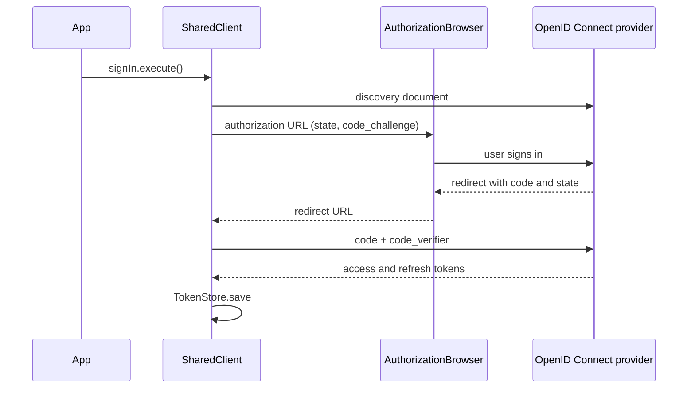

# Native clients

The Android app, the iOS app and the command-line client share one Kotlin Multiplatform library, `clients/shared` (`:clients:shared`). It holds everything that talks to the API: the client generated from the contract, the OpenID Connect sign-in, and the use cases. The apps implement their UI and a few platform adapters, nothing else.

## A hexagon, like an API module

```text
clients/shared/src/commonMain/kotlin/dev/ylp/client/
├── SharedClient.kt              composition root: builds everything, exposes the use cases
├── notes/
│   ├── domain/                  Note, NotePage, NoteDraft (the contract's limits), results, NoteGateway (port)
│   ├── application/             ListNotes, GetNote, CreateNote, UpdateNote, DeleteNote
│   └── adapter/out/http/        HttpNoteGateway, over the generated client
└── auth/
    ├── domain/                  Tokens, AuthConfig, ports: TokenStore, AuthorizationBrowser, IdentityProvider
    ├── application/             SignIn, SignOut, CurrentSession
    └── adapter/out/             oidc/KtorIdentityProvider, memory/InMemoryTokenStore
```

- **The domain** holds the model and the ports. It knows neither Ktor nor the generated code.
- **A use case** is a class with one `execute` method. It checks its input against the contract's limits before any call, so a screen can show the problem without a round trip.
- **Adapters** are `internal`. A platform reaches the library through `SharedClient` and its use cases only.
- **The generated client** (`dev.ylp.client.generated`) is `internal` too, and only the HTTP adapter and the composition root use it.

`ArchitectureTest` (Konsist, in `jvmTest`) checks these rules, as `HexagonalArchitectureTest` does for the API.

## What a platform provides

| Port | Role | Android | iOS | CLI |
| --- | --- | --- | --- | --- |
| `AuthorizationBrowser` | Opens the provider's sign-in page and returns the redirect URL, or null when the user cancels | `CustomTabsBrowser`: a Custom Tab, the redirect back through `dev.ylp.notes://callback` | `ASWebAuthenticationSession` | the device flow, no browser |
| `TokenStore` | Keeps the tokens between launches | `KeystoreTokenStore`: AES-GCM with a key of the AndroidKeyStore, excluded from backups | Keychain | Keychain, libsecret, or an owner-only file |

The Android app (`clients/android`) implements its column: see [Run the Android app](../contributor/how-to/run-the-android-app.md).

`InMemoryTokenStore` is the default: tokens live as long as the process. An app then builds the client once:

```kotlin
val client = SharedClient(
    apiBaseUrl = "https://example.org/api/v1",
    auth = AuthConfig(issuer = "https://idp.example.org", clientId = "mobile", redirectUri = "dev.ylp.notes://callback"),
    browser = platformBrowser,
    tokenStore = platformTokenStore,
)
when (val result = client.listNotes.execute()) {
    is NotePageResult.Success -> show(result.page.notes)
    is NotePageResult.Failed -> show(result.failure)
}
```

## Sign-in

The library implements Authorization Code with PKCE (RFC 7636, `S256`) itself, rather than through a per-platform library such as AppAuth: the protocol is written and tested once, for every platform.



- A redirect whose `state` differs from the request's is refused: it does not answer this sign-in.
- Every API call carries the stored access token. On a 401 the library refreshes it once and retries; if the refresh fails, it clears the store and the call answers `SignedOut`.
- `Tokens` and `AuthorizationRequest` hide their secrets from `toString`, so a log never prints them.

## Errors

| API answer | Result |
| --- | --- |
| 401 after a failed refresh, or no session | `NoteFailure.SignedOut` |
| 404 | `NoteFailure.NotFound`: missing, or someone else's |
| 400, 413 | `NoteFailure.Invalid`, with the problem's `detail` |
| Anything else, or no network | `NoteFailure.Unavailable` |

## Within Swift export's limits

The iOS app reaches the library through Kotlin's Swift export, still in Alpha. It supports `final` classes inheriting from `Any`, sealed classes (as Swift enums), `suspend` functions (as `async`) and `Flow` (as `AsyncSequence`), but not generic types or functions. Hence the public API:

- returns one sealed result type per operation (`NoteResult`, `NotePageResult`, `DeleteNoteResult`) rather than a generic `Result<T>`;
- exposes `data` classes and sealed hierarchies only.

`ArchitectureTest` fails when a public class, interface or function declares a type parameter. If Swift export blocks on a construct, the fallback is the Objective-C export with SKIE.

## The generated client

The `openapi-kotlin-client` convention generates Ktor calls and kotlinx.serialization models in `commonMain` on every build. Two quirks of the generator are handled:

- its multiplatform templates ignore `nonPublicApi` in a few files, so the build makes every generated top-level declaration `internal` afterwards;
- it renames a property called `size` to `propertySize`.

A contract change regenerates the client, and the HTTP adapter stops compiling where it no longer matches.

## Targets and tests

| Target | Used by | Tests |
| --- | --- | --- |
| `android` | the Android app | `commonTest` on the host JVM |
| `iosArm64`, `iosSimulatorArm64` | the iOS app | `commonTest` on the simulator, macOS with Xcode only |
| `jvm` | nothing shipped | `commonTest`, `ArchitectureTest`, Kover |

Tests use Ktor's `MockEngine` for the API and the provider. See the [testing strategy](testing-strategy.md).
