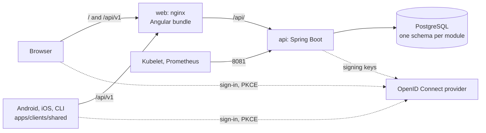

# Architecture overview

## Runtime



The web app and the API share one origin: nginx serves the bundle and proxies `/api/` to the API, so the browser needs no CORS. The API listens on 8080 for the application and on 8081 for Actuator, a port no ingress routes.

## One deployable, several modules

The API is a single Spring Boot application organised as a **Spring Modulith**. Each direct sub-package of `dev.ylp` is an application module:

| Package | Role |
| --- | --- |
| `notes` | a business module, the example to copy |
| `shared` | an *open* module every module may use: identifier generation, `BusinessException`, `TechnicalException` |
| `config` | cross-cutting configuration: security, clock, API path prefix, request size limit |

`ApplicationModules.verify()` (in `ModularityTest`) fails the build when a module reaches into another module's internals. One JVM keeps the memory footprint low on a small node; the module boundaries keep the option of extracting a service later.

Each module owns its **database schema** (`notes.notes`) and its Liquibase changelog, included by `db.changelog-master.yaml`. No query joins two schemas: a module reads another module's data through its Java API or its events.

## Hexagonal inside a module

```text
notes/
├── domain/        Note (aggregate), value objects, NoteRepository (port), NoteErrorReason
├── application/   one use case per class: CreateNoteUseCase, ListNotesUseCase...
├── adapter/in/    rest: NotesController, mapper, CurrentOwner
├── adapter/out/   postgres: JPA entity, Spring Data repository, PostgresNoteRepository
└── NotesConfiguration.java   declares the use cases as beans
```

- **The domain** holds the model and the **ports** it needs (`NoteRepository`). It depends on no framework.
- **A use case** is a concrete class with an `execute` method taking a command record. Its only Spring dependency is `@Transactional`; it is declared in the module's `@Configuration` rather than annotated as a component.
- **Adapters** implement ports (`adapter/out`) or drive use cases (`adapter/in`). They are the only place where Spring MVC, JPA or Spring Data appear.

These rules are executable. jMolecules annotations declare the roles (`@AggregateRoot` and `@ValueObject` in the domain, `@SecondaryPort` on ports, `@PrimaryPort` on `application` and `@PrimaryAdapter` and `@SecondaryAdapter` on the adapters' `package-info.java`), and `HexagonalArchitectureTest` checks them with `jmolecules-archunit`, plus one rule: `domain` and `application` depend neither on Spring (except `@Transactional`) nor on adapters.

The same annotations draw the [domain model](domain-model.md) page: `ModularityTest` generates it from the module model, with each module's dependencies, model and request flow.

## Domain modelling

- **Value objects are records** that validate themselves in their compact constructor (`Title`, `Content`, `OwnerId`, `PageRequest`) and raise a `BusinessException` with `InvalidRecordReason.CONSTRAINT_VIOLATION`.
- **Entities have typed identities** (`NoteId`), generated by the application through `UUIDGenerator` (never by the database), and compare by identity only.
- **An aggregate changes through business methods** (`Note.edit`) and is persisted whole by its port.
- **Business errors** are one `BusinessException` type with a reason enum per module; the reason declares its category (`NOT_FOUND`, `INVALID`, `CONFLICT`, `RULE_VIOLATION`), and only the REST adapter turns it into a status: `ProblemDetailsExceptionHandler` maps `NOT_FOUND` to 404, `INVALID` to 400, `CONFLICT` to 409 and `RULE_VIOLATION`, the default, to 422. What a caller receives: [API errors](../product/api-errors.md).
- **Time and identity are injected** (`Clock`, `UUIDGenerator`), so tests fix both.

## The web app

Angular, zoneless, organised by feature (`src/app/notes`, `src/app/auth`). A feature has a store built on signals, a thin client over the generated API client (the seam tests replace), and its components. Configuration that varies by environment is read at runtime from `/config.json`.

## The native clients

The Android, iOS and command-line clients share a Kotlin Multiplatform library, `apps/clients/shared`, organised as a hexagon like an API module: the API client generated from the contract, the OpenID Connect sign-in and the use cases live there, and each app implements its UI and a few platform adapters. See [Native clients](clients.md).
