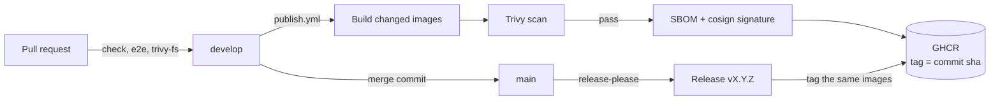

# Supply chain

## Delivery flow

## Principles

- **Pin everything.** Libraries in the version catalog, build tools in `gradle.properties`, GitHub Actions by commit SHA, base images and the mock identity provider by digest. A build today and a build next month resolve the same bytes.
- **Update continuously.** Renovate proposes every update after seven days, merges patch, minor and digest updates once CI passes, and leaves majors and the frameworks the application runs on (Spring, Angular, PostgreSQL) for review. See [Update dependencies](../operations/update-dependencies.md).
- **Scan at both ends.** `trivy-fs` scans the repository (dependencies including development tooling, secrets, configuration) on every pull request; each published image is scanned again. Fixable `HIGH` and `CRITICAL` findings fail.
- **Sign what passed.** An image is signed only after its scan passes, keyless: cosign gets a short-lived certificate for the workflow's GitHub OIDC identity and records the signature in Sigstore's transparency log. There is no signing key to store or leak. The SBOM is attested the same way.
- **Promote, never rebuild.** A release adds its version tag to the images already built, tested and signed from `develop`; the bytes that were verified are the bytes that ship.
- **No long-lived secret in CI.** Publishing uses the workflow's `GITHUB_TOKEN`; signing uses its OIDC token.

The scan earned its place on day one: the first image publication refused to sign the API because Spring Boot 4.1.1 brought vulnerable Tomcat and Jackson versions, fixed by moving to 4.1.2.

## Verifying an image

See [CI/CD](../operations/ci-cd.md#images) for the `cosign verify` command.
